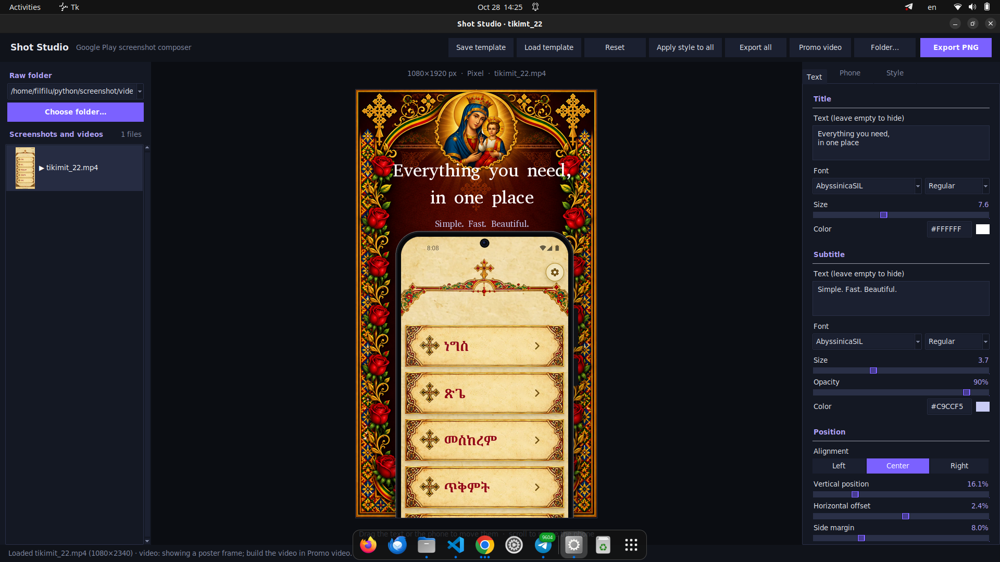
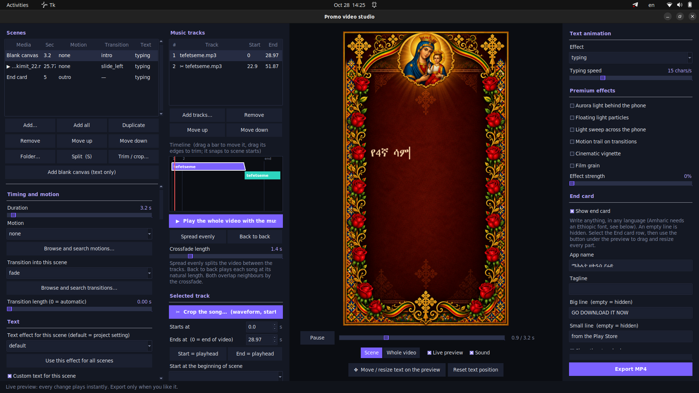

# Shot Studio

## At a glance

Two ways to work with the same design system:

<div align="center">
  <table>
    <tr>
      <td align="center">
        
        <br />
        <strong>Screenshot creator</strong>
      </td>
      <td align="center">
        
        <br />
        <strong>Video promo scene</strong>
      </td>
    </tr>
  </table>
</div>

<div align="center" style="margin-top: 18px;">
  <a href="https://drive.google.com/file/d/1KfY38gm6mqLovcw2uf00ZxRnu0RNLK92/view?usp=sharing" target="_blank">
    
  </a>
</div>

<p align="center">
  <a href="https://drive.google.com/file/d/1KfY38gm6mqLovcw2uf00ZxRnu0RNLK92/view?usp=sharing" target="_blank">
    ▶ Watch the promo video on Google Drive
  </a>
</p>

Shot Studio is a local desktop app for turning app screenshots and promo footage into polished Google Play-style marketing graphics. It can compose still promo images, apply one design across many shots, and render MP4 promo videos from the same visual system.

This project is designed to stay fully local and offline. No cloud service is required.

## What it does

- Loads screenshots and videos from a selected raw folder
- Lets you edit text, layout, phone frame, colors, glow, background, and crop in a live preview
- Exports high-resolution PNG promo images for app stores and landing pages
- Applies one style across an entire batch of images
- Saves and reloads reusable design presets
- Builds promo videos with scene timing, transitions, music, and ending cards
- Supports custom device frames, fonts, and background images

## Requirements

- Python 3.9+
- Tkinter for the desktop UI
- FFmpeg for video export
- A source folder containing screenshots and/or videos

### Install Python

Download Python from https://www.python.org/downloads/ and make sure the installer adds Python to PATH on Windows.

### Install FFmpeg

FFmpeg is required for promo-video export.

- Windows: `winget install Gyan.Dev.FFmpeg` or install from https://www.ffmpeg.org/download.html
- macOS: `brew install ffmpeg`
- Linux: `sudo apt install ffmpeg`

Verify installation:

```bash
ffmpeg -version
```

## Install dependencies

Clone the project and set up a virtual environment:

```bash
git clone <your-repo-url>
cd <your-repo-folder>
python3 -m venv .venv
source .venv/bin/activate   # Windows: .\.venv\Scripts\Activate.ps1
python -m pip install --upgrade pip
pip install -r requirements.txt
```

The project dependencies are small:

- Pillow
- pygame

If your Linux environment is missing Tkinter, install it as well:

```bash
sudo apt install python3-tk
```

## Run the app

From the project root:

```bash
python main.py
```

The app defaults to the repo-local project layout:

- `screenshots/raw` for source files
- `screenshots/output` for exported PNGs
- `screenshots/presets` for saved design presets

You can also point it to another project folder or a different raw folder:

```bash
python main.py --project "/path/to/project"
python main.py --raw "/path/to/raw/screenshots"
```

The app remembers recently used folders, so you can switch between projects without moving files.

## Project structure

```text
shot-studio/
├── main.py                 # app entry point
├── promo.py                # command-line promo video generator
├── config.py               # defaults, canvas sizes, themes, project paths
├── circle_cropper.py       # helper for crop/circle operations
├── requirements.txt        # python dependencies
├── README.md               # project docs
├── scenes.example.json     # example scene JSON for video generation
├── assets/
│   ├── backgrounds/       # custom background images
│   ├── fonts/             # custom fonts (.ttf/.otf)
│   ├── frames/            # custom phone/device frame PNGs
│   └── video/             # optional promo assets like logo.png / play_badge.png
├── core/
│   ├── fonts.py
│   ├── frames.py
│   ├── renderer.py
│   └── settings.py
├── ui/
│   ├── app.py
│   ├── audio_cropper.py
│   ├── clip_editor.py
│   ├── theme.py
│   ├── video_dialog.py
│   └── widgets.py
├── video/
│   ├── animations.py
│   ├── audio.py
│   ├── clips.py
│   ├── engine.py
│   ├── fx.py
│   ├── picker.py
│   ├── premium.py
│   ├── timeline.py
│   ├── transitions.py
│   └── __init__.py
├── screenshots/
│   ├── raw/               # source screenshots/videos
│   ├── output/            # exported PNG files
│   └── presets/           # saved design presets and promo settings
└── ...
```

## How the app workflow works

1. Put screenshots or videos into a raw folder.
2. Open Shot Studio.
3. Use the left panel to choose a project/raw folder.
4. Pick a screenshot or video from the list.
5. Adjust the app title/subtitle, frame style, colors, glow, and layout in the live preview.
6. Export the current image, export all images, or save a reusable preset.
7. Open the promo-video workflow to generate an MP4 from scenes and audio.

The preview updates live while you edit, so visual changes are visible immediately.

## Exporting static promo images

The app exports PNGs to:

```text
screenshots/output/
```

or to a project-scoped output folder created beside the raw folder when using a custom project layout.

If the raw folder is named `raw`, the app stores additional project data in the parent folder:

```text
<project>/screenshots/
├── raw/
├── output/
└── presets/
```

If the raw folder is something else, the app uses a folder-local `_studio` structure:

```text
<folder>/
├── raw-or-custom-name/
├── _studio/
│   ├── output/
│   └── presets/
```

## Saving and reusing styles

The app includes:

- `Load template`
- `Save template`
- `Apply style to all`

This lets you design one look and then reuse it across many images without overwriting per-shot text or crop settings.

## Promo video generation

You can build a promo video either from the app UI or from the command line.

### From the app

Open the app and click the `Promo video` button in the toolbar.

### From the command line

```bash
python promo.py --name "My App" --tagline "Everything in one place"
python promo.py --screens screenshots/raw --template screenshots/presets/01.json --music song.mp3 --fps 60
python promo.py --scenes scenes.example.json
```

The CLI supports:

- `--project` and `--raw` folder selection
- `--screens` for explicit screenshot/video files or folders
- `--template` for reusing a saved design preset
- `--scenes` for a full scene list/JSON project definition
- `--music`, `--quality`, `--fps`, `--duration`, and `--out` controls
- end-card headline/subline and outro toggles

## Custom assets

You can extend the app by placing files in these folders:

- `assets/backgrounds/` for custom background images
- `assets/frames/` for device or frame PNGs
- `assets/fonts/` for custom `.ttf` or `.otf` fonts
- `assets/video/` for optional promo graphics like `logo.png` and `play_badge.png`

The app scans these folders automatically to populate the built-in pickers in the UI.

## Typical usage flow

```bash
python main.py
```

Then:

1. choose your raw folder
2. pick a screenshot
3. tune the layout and theme
4. export the PNGs or save them as a template
5. create a promo MP4 using the same look

## Troubleshooting

### `ModuleNotFoundError: No module named 'PIL'`

```bash
pip install -r requirements.txt
```

### `Tkinter` errors on Linux

```bash
sudo apt install python3-tk
```

### `ffmpeg: command not found`

Install FFmpeg and ensure it is in your PATH.

### App opens but no images show up

Check that your raw folder contains real image or video files such as `.png`, `.jpg`, `.jpeg`, `.webp`, `.mp4`, `.mov`, or `.webm`.

## License

This project is intended for local, offline use and can be adapted to your own design workflow.

## Quick start

```bash
git clone <your-repo-url>
cd <your-repo-folder>
python3 -m venv .venv
source .venv/bin/activate    # Windows: .\.venv\Scripts\Activate.ps1
python -m pip install --upgrade pip
pip install -r requirements.txt
python main.py
```

If you want to go further, this project can also be extended with your own frames, fonts, motion presets, or branded end-card assets.
